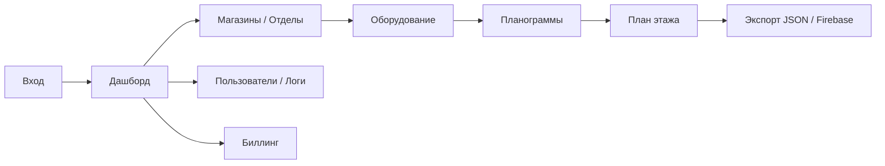

# Обзор продукта

Текущая версия: **2.7** (см. корневой `VERSION` / [README](../README.md)).  
Лицензия: **proprietary** — см. [LICENSE](../LICENSE) (не MIT / не публичный open source).

## Что это

**PLNA Web Backend** — production control center экосистемы PLNA для розничных планограмм. Это не «сайт-витрина» и не MVP-прототип, а рабочая multi-tenant система для сотрудников сети и магазинов: планирование выкладки, учёт оборудования, биллинг и синхронизация с мобильным приложением.

## Зачем

В ритейле планограмма отвечает на вопросы: *какой товар*, *на какой полке*, *в каком магазине*, *в каком порядке и с какими фейсингами*. Без единой системы данные разъезжаются между Excel, локальными файлами и телефоном мерчандайзера.

Платформа даёт:

1. **Единый источник правды** по магазинам, отделам, SKU и оборудованию.
2. **Визуальную и структурированную планограмму** (полки / холодильники / стенды + план зала).
3. **Контроль доступа** по ролям и арендаторам (tenant).
4. **Выгрузку в Firebase**, чтобы мобильный клиент получал актуальные данные магазина.
5. **Коммерческий контур** — тарифы, подписки, счета, юридические документы.

## Для кого

| Роль в системе | Типичная задача |
|----------------|-----------------|
| Super Admin | Платформа: все tenant, тарифы, счета, БД, system logs |
| Заместитель (Tenant Admin) | Сеть: магазины, юзеры tenant, аналитика, подписка |
| Заведующий (Store/Dept Manager) | Свой отдел/магазин: карта зала, планограммы, оборудование |
| Программист (Integrator) | API-only: view-stores/products + export |
| Мерчандайзер | Только mobile/API (веб-панель закрыта) |

Подробнее: [ROLES.md](ROLES.md).

## Как выглядит работа пользователя (упрощённо)

1. Арендатор (tenant) активен и имеет действующую подписку.
2. Пользователь настраивает магазины и отделы.
3. Создаёт оборудование (полки, холодильники, стенды) с уровнями.
4. Размещает товары на уровнях (placements).
5. При необходимости правит план зала.
6. Генерирует JSON и/или отправляет магазин в Firebase.

## Что система не делает

- Не заменяет кассовую / ERP систему (нет полноценного складского учёта продаж).
- Не хостит мобильное приложение — только backend + панель + синхронизация в Firebase RTDB.
- Не хранит секреты Firebase в git — только на сервере / в настройках UI.

## Связанные документы

- Архитектура: [ARCHITECTURE.md](ARCHITECTURE.md)
- Модули: [MODULES.md](MODULES.md)
- Firebase: [FIREBASE.md](FIREBASE.md)
